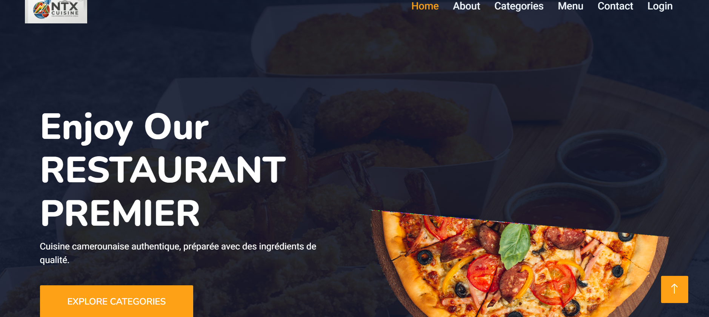

# ferol_restau

Application web de présentation des menus, vins et catégories du **RESTAURANT PREMIER** (NTX Cuisine) : cuisine authentique, préparée avec des ingrédients de qualité.




## Sommaire

- [Présentation](#présentation)
- [Technologies](#technologies)
- [Installation](#installation)
- [Fonctionnalités](#fonctionnalités)
- [Base de données](#base-de-données)
- [Structure du projet](#structure-du-projet)
- [Captures d'écran](#captures-décran)
- [Auteur](#auteur)

## Présentation

**ferol_restau** est une application web de type **SPA (Single Page Application)** :
toutes les fonctionnalités sont accessibles depuis la page d'accueil (`index.php`)
grâce au menu de navigation (Home, About, Categories, Menu, Contact, Login).

## Technologies

| Couche          | Technologie                                                   |
|-----------------|---------------------------------------------------------------|
| Backend         | PHP 5                                                         |
| Frontend        | HTML, Bootstrap (CSS + librairies JavaScript)                 |
| Styles          | Liens CDN (mode connecté) ou SCSS local (mode hors ligne)     |
| Base de données | MySQL (gérée via phpMyAdmin)                                  |
| Serveur local   | XAMPP (Apache + MySQL)                                        |

## Installation

### Prérequis

- [XAMPP](https://www.apachefriends.org/) (Apache + MySQL)
- Un navigateur web récent

### Étapes

1. **Copier** le dossier `ferol_restau` dans `C:\xampp\htdocs`.
2. **Démarrer** XAMPP, puis lancer les services `Apache` et `MySQL`.
3. **Créer et importer** la base de données `food-order` depuis phpMyAdmin
   (`http://localhost/phpmyadmin`) avec le fichier SQL du dossier `sql/`.
4. **Configurer** la connexion à la base de données dans le dossier `config/`
   (hôte, utilisateur, mot de passe).
5. **Lancer** l'application :

   ```
   http://localhost/ferol_restau
   ```

## Fonctionnalités

| Page       | Fichier          | Description                                                      |
|------------|------------------|------------------------------------------------------------------|
| Home       | `index.php`      | Affiche l'ensemble des éléments du site sur une seule page       |
| About      | `about.php`      | Présentation générale du restaurant                              |
| Categories | `categories.php` | Présente les différents menus (table `tbl_category`)             |
| Menu       | `menu.php`       | Affiche les plats (table `tbl_food`)                             |
| Contact    | `contact.php`    | Permet aux visiteurs de poster des messages (table `message`)    |
| Login      | `login.php`      | Connexion des utilisateurs enregistrés (table `users`)           |
| Register   | `register.php`   | Inscription des nouveaux utilisateurs                            |
| Logout     | `logout.php`     | Déconnexion                                                      |

## Base de données

Nom de la base : `food-order`

| Table          | Rôle                                       |
|----------------|--------------------------------------------|
| `tbl_category` | Catégories de menus                        |
| `tbl_food`     | Plats du restaurant                        |
| `message`      | Messages envoyés via le formulaire contact |
| `users`        | Utilisateurs enregistrés                   |

## Structure du projet

```
ferol_restau/
├── config/          # Configuration (connexion base de données)
├── css/             # Feuilles de style
├── scss/            # Sources SCSS (mode hors ligne)
├── js/              # Scripts JavaScript
├── lib/             # Librairies tierces
├── images/          # Images du site
├── img/             # Images du site
├── includes/        # Composants PHP réutilisables
├── sql/             # Script d'import de la base de données
├── index.php
├── about.php
├── categories.php
├── menu.php
├── contact.php
├── message.php
├── login.php
├── register.php
├── logout.php
└── README.md
```

## Captures d'écran

| Accueil | Services | À propos |
|---------|----------|----------|
|  |  |  |

## Auteur

**Ferol Tatang Fomekon** — [GitHub : TatangF](https://github.com/TatangF)